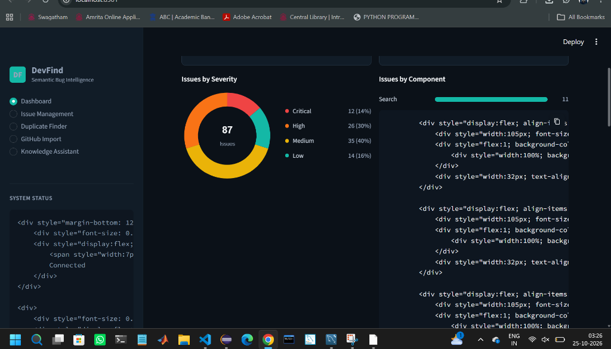
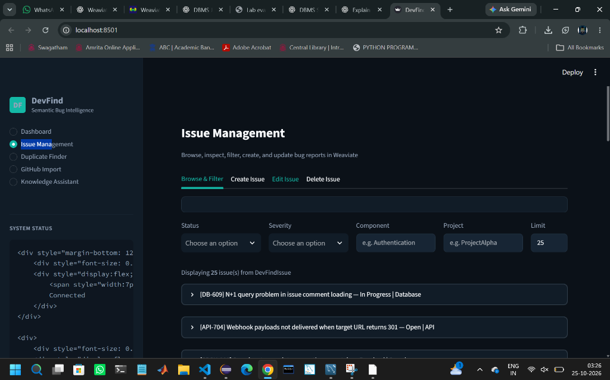
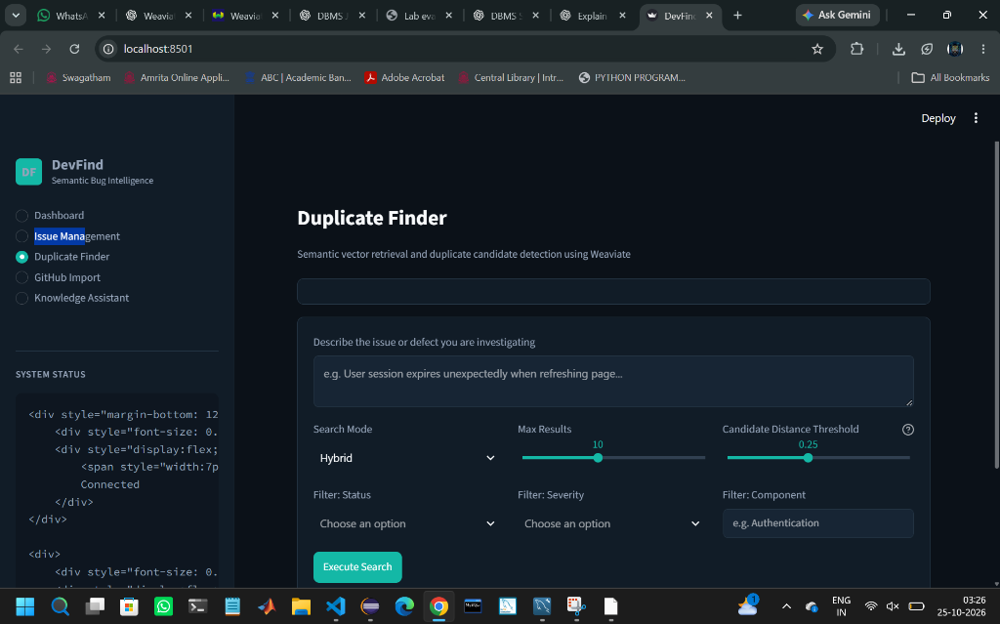
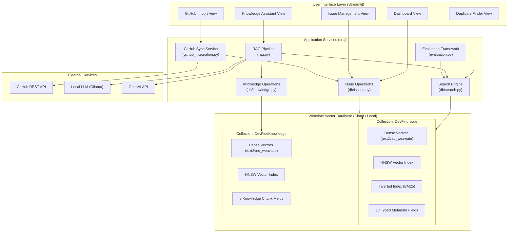

# DevFind — Semantic Bug & Issue Intelligence Platform

[](https://www.python.org/downloads/)
[](https://weaviate.io/)
[](https://streamlit.io/)
[](https://github.com/aadiur/DevFind/actions/workflows/ci.yml)
[](LICENSE)
[](https://github.com/psf/black)

> An enterprise-grade developer issue intelligence platform powered by Weaviate, semantic vector search, hybrid retrieval (BM25 + Dense Vectors), and Retrieval-Augmented Generation (RAG).

---

## 1. Overview

**DevFind** is a developer intelligence platform engineered to eliminate duplicate bug triage, accelerate root-cause identification, and unlock organizational debugging knowledge. By centering its persistence architecture on **Weaviate**, DevFind provides real-time vector search across thousands of software incident reports, identifies semantic duplicates regardless of phrasing divergence, synchronizes external repositories via GitHub API, and provides a citation-grounded RAG debugging assistant.

---

## 2. Problem Statement

Modern software engineering teams face severe friction in defect tracking:
- **Duplicate Triage Burden:** Up to 30% of incoming software bug reports are duplicates of previously reported or resolved issues.
- **Vocabulary Mismatch:** Different engineers and users describe the exact same underlying failure with completely disparate technical terms. For instance, *"NullPointerException when refreshing JWT"* and *"User logged out unexpectedly on page reload"* refer to the exact same defect, yet share zero non-stopword tokens.
- **Lost Remediation Knowledge:** When incidents are marked as resolved, the diagnostic steps, workarounds, and root causes are buried in closed tickets, forcing subsequent developers to re-investigate the same problem from scratch.
- **Keyword Search Failure:** Traditional inverted index search (BM25, Lucene, SQL `LIKE`) fails when queries lack exact keyword overlap with historical reports.

---

## 3. Motivation

DevFind was designed to bridge the gap between traditional relational issue trackers and modern vector-native databases. By demonstrating how Weaviate can serve as a primary operational datastore—handling vectorization, HNSW indexing, sparse-dense hybrid ranking, metadata filtering, and full CRUD—DevFind showcases production-grade information retrieval applied to daily developer workflows.

---

## 4. Key Features

- **Multi-Modal Search Engine:**
  - **Dense Vector Search (`near_text`):** Deep conceptual similarity using `text2vec_weaviate`.
  - **Hybrid Search:** Combines BM25 keyword matching with dense vectors using relative score fusion and a configurable $\alpha$ balance parameter ($0.0 \le \alpha \le 1.0$).
  - **Keyword Search (BM25):** Pure lexical baseline matching against `title` and `description`.
- **Intelligent Duplicate Discovery:** Real-time duplicate candidate flagging with adjustable cosine distance thresholds ($\le 0.25$), side-by-side issue inspection, and human-in-the-loop triage confirmation.
- **Comprehensive Issue Management (CRUD):** Complete lifecycle operations (Browse, Create, Edit, Delete, Filter) directly persisting to Weaviate collections.
- **Grounded RAG Knowledge Assistant:** Retrieval-Augmented Generation pipeline combining historical issues and runbook documentation with local (Ollama `llama3.2`) or cloud (OpenAI `gpt-4o-mini`) LLMs, complete with source citations and strict anti-hallucination guardrails.
- **Idempotent GitHub Integration:** Bi-directional sync importing issues from GitHub repositories with deterministic `uuid5` generation to prevent duplicate insertions across recurring imports.
- **Information Retrieval Evaluation Suite:** Standalone benchmarking framework evaluating Precision@K, Recall@K, Mean Reciprocal Rank (MRR), and latency across search modes.
- **Professional Developer UI:** Streamlit interface styled in a dark graphite-and-teal theme (`#0B1118` / `#14B8A6`) engineered for developer workflows.

---

## 5. Application Showcase

### Dashboard & Health Overview
*System health telemetry, collection counters, and component defect distribution.*


### Issue Management & CRUD
*Multi-parameter filtering, status triage, and defect metadata management.*


### Duplicate Finder & Triage Workflow
*Semantic candidate identification with configurable distance slider and review actions.*


---

## 6. System Architecture



---

## 7. Technology Stack & Design Rationale

| Component | Technology | Rationale |
|---|---|---|
| **Vector Database** | [Weaviate v4](https://weaviate.io/) | Native co-location of dense vectors and inverted BM25 indices; automatic embedding vectorization; high-performance HNSW indexing; robust Python client v4. |
| **Web Framework** | [Streamlit](https://streamlit.io/) | Rapid prototyping and reactive UI execution without the overhead of maintaining separate frontend build chains. |
| **Embedding Vectorizer** | `text2vec_weaviate` | In-database embedding generation eliminates client-side model inference bottlenecks and ensures synchronized schema vectorization. |
| **Optional LLM** | Ollama (`llama3.2`) / OpenAI | Offline, private, local model execution via Ollama with optional cloud fallback. |
| **Evaluation Suite** | Python / pytest / pandas | Standalone IR metrics computation (Precision, Recall, MRR) without heavy external dependencies. |
| **External Integration** | GitHub REST API v3 | Industry standard for developer issue tracking with fine-grained security tokens. |

---

## 8. Repository Directory Structure

```
DevFind/
├── .github/
│   ├── ISSUE_TEMPLATE/
│   │   ├── bug_report.yml          # GitHub bug report issue form
│   │   └── feature_request.yml     # GitHub feature request issue form
│   ├── pull_request_template.md    # Pull request template
│   └── workflows/
│       └── ci.yml                  # GitHub Actions CI matrix workflow
├── .streamlit/
│   └── config.toml                 # Dark theme styling configuration
├── data/
│   ├── eval_dataset.json           # 30 labeled IR evaluation queries
│   ├── knowledge_docs.json         # 25 software engineering knowledge chunks
│   └── sample_issues.json          # 82 synthetic software defect reports
├── docs/
│   ├── assets/                     # Application screenshots & diagrams
│   ├── architecture.md             # Detailed system architecture & schemas
│   ├── installation.md             # Comprehensive setup instructions
│   ├── usage.md                    # Module-by-module workflow user guide
│   ├── gen_docx.py                 # Case study report generator
│   └── gen_pptx.py                 # Case study presentation generator
├── results/
│   ├── eval_results.csv            # Detailed per-query evaluation output
│   ├── eval_results.json           # Per-query evaluation metrics
│   └── eval_summary.json           # Aggregated Precision, Recall, and MRR
├── src/
│   ├── db/
│   │   ├── __init__.py
│   │   ├── client.py               # Weaviate client factory & health checks
│   │   ├── issues.py               # Issue CRUD operations & batch upsert
│   │   ├── knowledge.py            # Knowledge chunk CRUD operations
│   │   ├── schema.py               # Collection definitions & startup guards
│   │   └── search.py               # Semantic, hybrid, and BM25 search engines
│   ├── __init__.py
│   ├── evaluation.py               # Precision@k, Recall@k, and MRR calculators
│   ├── github_integration.py       # GitHub REST sync & UUID normalization
│   ├── rag.py                      # Grounded RAG orchestrator with citations
│   └── utils.py                    # Input validation, hashing & date helpers
├── tests/
│   ├── __init__.py
│   ├── test_db_integration.py      # Weaviate CRUD & schema integration tests
│   ├── test_github.py              # GitHub API sync & pagination tests
│   ├── test_rag.py                 # RAG context builder & LLM caller tests
│   ├── test_search.py              # Search parameter & filter tests
│   └── test_utils.py               # Data normalization & UUID5 tests
├── .env.example                    # Template environment variables (no secrets)
├── .gitignore                      # Git exclusion rules
├── CHANGELOG.md                    # Project release changelog
├── CODE_OF_CONDUCT.md              # Community standards
├── CONTRIBUTING.md                 # Contribution guidelines
├── LICENSE                         # MIT License
├── README.md                       # Master project documentation
├── app.py                          # Streamlit application entry point
├── devfind_demo.py                 # Self-contained classroom demo script
├── pytest.ini                      # Pytest configuration and markers
├── requirements.txt                # Production dependencies
├── reset_db.py                     # Safe database reset utility
└── run_eval.py                     # Standalone evaluation runner
```

---

## 9. Installation & Quickstart

### Prerequisites
- Python 3.10+
- Weaviate instance (Free [Weaviate Cloud](https://console.weaviate.cloud) or local Docker)

```bash
# 1. Clone the repository
git clone https://github.com/aadiur/DevFind.git
cd DevFind

# 2. Create and activate a virtual environment
python -m venv .venv
source .venv/bin/activate  # On Windows: .venv\Scripts\activate

# 3. Install dependencies
pip install -r requirements.txt

# 4. Configure environment
cp .env.example .env
# Open .env and add your WEAVIATE_URL and WEAVIATE_API_KEY
```

For complete setup instructions, see [docs/installation.md](docs/installation.md).

---

## 10. Running the Application

Launch the Streamlit web dashboard:
```bash
streamlit run app.py
```
Open `http://localhost:8501` in your browser.

- Click **"Load Synthetic Issues"** on the Dashboard to seed 82 realistic software bug reports.
- Navigate to **Duplicate Finder** to execute semantic queries.
- Navigate to **Issue Management** to inspect and filter indexed records.

---

## 11. Weaviate Database Collections & Schema

DevFind automatically initializes two collections via `ensure_startup_collections()` in `src/db/schema.py`:

1. **`DevFindIssue` (Primary Defect Collection):**
   - 17 typed properties including `title`, `description`, `component`, `severity`, `status`, `resolution`, `review_status`, and `tags`.
   - Vectorizer: `text2vec_weaviate` configured across descriptive text fields.
   - Index: Inverted index for BM25 term lookups and HNSW graph for vector similarity.
2. **`DevFindKnowledge` (RAG Context Collection):**
   - 8 typed properties storing runbooks, troubleshooting steps, and architectural documentation chunks.
   - Vectorizer: `text2vec_weaviate`.

---

## 12. Retrieval Mechanisms Deep-Dive

### Semantic Vector Search
Calculates the **Cosine Distance** between the query embedding and stored issue vectors:

$$\text{Cosine Distance} = 1 - \frac{\vec{q} \cdot \vec{d}}{\|\vec{q}\| \|\vec{d}\|}$$

Issues with $\text{Distance} \le 0.25$ are flagged as potential duplicate candidates.

### Hybrid Retrieval (Sparse + Dense)
Hybrid search balances semantic understanding with exact token matching (e.g., error codes like `AUTH-004` or `ConnectionResetError`):

$$\text{Score}_{\text{hybrid}} = \alpha \cdot \text{Score}_{\text{dense}} + (1 - \alpha) \cdot \text{Score}_{\text{BM25}}$$

- $\alpha = 1.0$: Pure vector search.
- $\alpha = 0.0$: Pure BM25 keyword search.
- $\alpha = 0.70$ (Default): 70% semantic emphasis, 30% lexical keyword emphasis.

---

## 13. Retrieval-Augmented Generation (RAG) Pipeline

The Knowledge Assistant (`src/rag.py`) allows developers to query debugging knowledge with strict factual grounding:
1. **Parallel Vector Retrieval:** Queries `DevFindIssue` for historical resolutions and `DevFindKnowledge` for architectural guides.
2. **Context Formatting:** Assembles structured excerpts with unique source identifiers.
3. **Constrained Prompting:** Instructs the LLM to rely strictly on provided evidence and state uncertainties explicitly.
4. **Source Attribution:** Parses and verifies source citations before rendering results to the user.

---

## 14. GitHub Integration

DevFind synchronizes live GitHub issues via `src/github_integration.py`:
- **Deterministic Keying:** Generates stable UUIDv5 identifiers from repository name and issue number (`uuid5(NAMESPACE_URL, "github://owner/repo/issues/123")`), guaranteeing idempotency across recurring syncs.
- **Dry-Run Mode:** Simulates synchronization and reports additions/modifications without persisting changes.
- **Label & State Mapping:** Converts GitHub states (`open`, `closed`) and labels (`critical`, `bug`, `backend`) into DevFind's typed schema.

---

## 15. Evaluation Methodology & Metrics

DevFind includes a standardized evaluation suite (`src/evaluation.py`):

- **Precision@K ($P@K$):** Percentage of top-$K$ retrieved issues that are genuinely relevant.
- **Recall@K ($R@K$):** Percentage of all relevant issues successfully captured within the top-$K$.
- **Mean Reciprocal Rank (MRR):** Evaluates how quickly the first relevant issue is surfaced:
  $$\text{MRR} = \frac{1}{|Q|} \sum_{i=1}^{|Q|} \frac{1}{\text{rank}_i}$$

Run the benchmark suite:
```bash
python run_eval.py
```
Output results are exported to `results/eval_results.csv` and `results/eval_results.json`.

---

## 16. Testing Instructions

The test suite contains 158 tests covering CRUD operations, search mechanics, GitHub synchronization, RAG logic, and data normalization:

```bash
# Run all unit and mocked integration tests (no live credentials required)
python -m pytest tests/ -v

# Run with coverage report
python -m pytest --cov=src tests/

# Run live Weaviate cloud tests (requires WEAVIATE_URL and WEAVIATE_API_KEY in .env)
python -m pytest tests/test_db_integration.py -v -k "Live"
```

CI automatically executes all non-live tests across Python 3.10, 3.11, and 3.12 on both Ubuntu and Windows runners.

---

## 17. Limitations

- **Synthetic Evaluation Set:** The bundled evaluation dataset contains 30 labeled queries and 82 issues; while effective for comparative analysis between search algorithms, production calibration requires larger organization-specific corpora.
- **Vectorizer Dependency:** Requires a Weaviate cluster with the `text2vec_weaviate` or compatible vectorizer module enabled.
- **Authentication:** The Streamlit interface is intended for internal developer workflows and does not implement a multi-tenant user authentication layer.

---

## 18. Future Roadmap

- [ ] Support for local ONNX/HuggingFace client-side vectorizers as alternatives to cloud vectorizers.
- [ ] Automated Slack / Microsoft Teams webhook integration for real-time duplicate alerts.
- [ ] Multi-repository synchronization daemon with incremental polling.
- [ ] Cross-encoder re-ranking step (e.g., `bge-reranker-large`) on top of hybrid retrieval results.

---

## 19. Contributing

We welcome community contributions! Please review our [Contributing Guidelines](CONTRIBUTING.md) and [Code of Conduct](CODE_OF_CONDUCT.md) before submitting a pull request.

---

## 20. License

This project is licensed under the **MIT License**. See the [LICENSE](LICENSE) file for complete details.

---

## 21. Author & Acknowledgments

- **Author:** [Karthik m]
- **Contact:** `umamadhukarthikm@gmail.com`
- **Acknowledgments:** Developed as a practical demonstration of vector-native software engineering and information retrieval powered by Weaviate.
