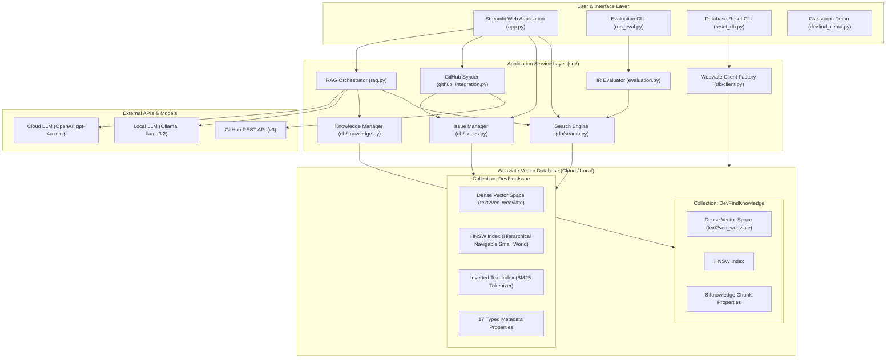
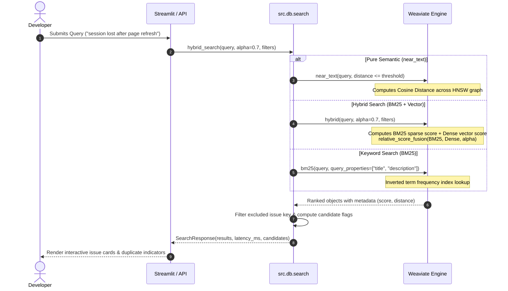
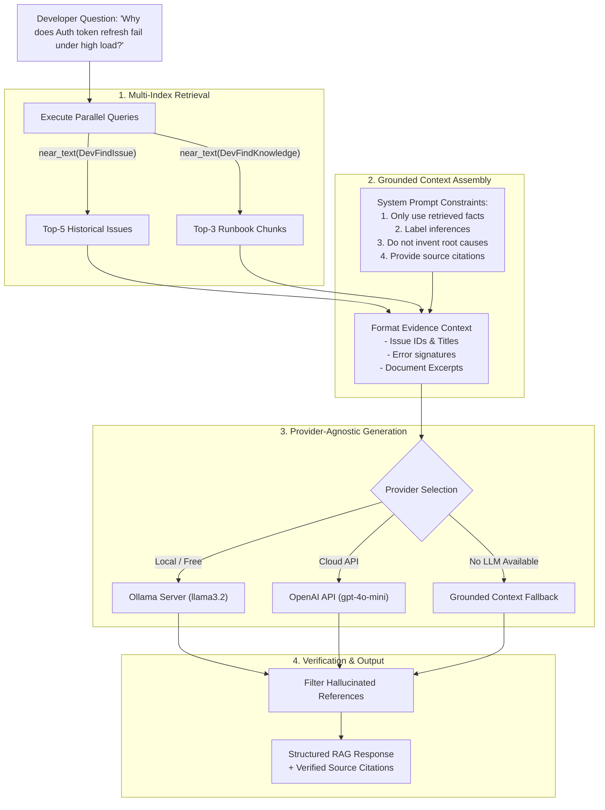
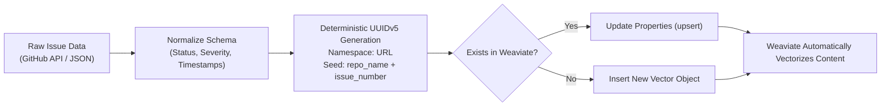

# DevFind System Architecture & Technical Deep-Dive

This document details the architectural design, database schemas, retrieval mechanisms, and information retrieval evaluation methodology of **DevFind: Semantic Bug & Issue Intelligence Platform**.

---

## 1. Executive Architecture Overview

DevFind uses **Weaviate** as its foundational vector and search database. Rather than treating a vector database merely as an external cache or index plugin, DevFind centers its entire persistence model around Weaviate collections.

---

## 2. Why Weaviate?

Traditional relational databases (PostgreSQL, MySQL) and pure inverted index search engines (Elasticsearch, OpenSearch) struggle with semantic divergence in bug reports:

1. **Vocabulary Mismatch Problem:** Developers and end-users describe identical technical defects using completely different terminology. For example:
   - Report A: *"Unhandled NullPointerException when access token is revoked during refresh cycle."*
   - Report B: *"User gets unexpectedly logged out after browser reload."*
   A keyword search for `login session reload` will completely miss Report A despite describing the exact same underlying authentication defect.
2. **Native Vector + Inverted Index Co-Location:** Weaviate couples dense vector embeddings with inverted BM25 indices within a single database engine. This enables sub-millisecond **hybrid search** without requiring dual-database synchronization pipelines.
3. **Managed Embedding Vectorizers (`text2vec_weaviate`):** Weaviate manages embedding generation directly inside the database cluster, eliminating client-side embedding boilerplate and inference latency bottlenecks.
4. **Strong Typing & Filter Graph:** High-dimensional vector searches can be constrained simultaneously by multi-property metadata filters (e.g., `component == "Authentication" AND severity == "Critical"`).

---

## 3. Database Schema & Collections

DevFind defines two primary collections in Weaviate:

### 3.1 `DevFindIssue` Collection (17 Properties)

| Property Name | Data Type | Vectorized | Description |
|---|---|---|---|
| `issue_key` | Text | No | Unique human identifier (e.g., `AUTH-101`, `GH-42`) |
| `title` | Text | **Yes** | Concise summary of the defect |
| `description` | Text | **Yes** | Detailed steps to reproduce, symptoms, and environment |
| `severity` | Text | No | `Critical`, `High`, `Medium`, `Low` |
| `status` | Text | No | `Open`, `In Progress`, `Resolved`, `Closed` |
| `component` | Text | No | System module (e.g., `Authentication`, `Database`, `UI`) |
| `project` | Text | No | Project identifier |
| `resolution` | Text | **Yes** | Root cause analysis and resolution steps |
| `created_at` | Text | No | ISO-8601 creation timestamp |
| `updated_at` | Text | No | ISO-8601 last modified timestamp |
| `source` | Text | No | `synthetic`, `github`, or `manual` |
| `source_url` | Text | No | Direct URL to original issue |
| `duplicate_of` | Text | No | Key of confirmed parent duplicate |
| `review_status` | Text | No | `pending`, `confirmed_dup`, `distinct` |
| `reviewed_by` | Text | No | Identity of triaging developer |
| `reviewed_at` | Text | No | ISO-8601 timestamp of review action |
| `tags` | Text[] | No | Free-form searchable tags |

### 3.2 `DevFindKnowledge` Collection (8 Properties)

| Property Name | Data Type | Vectorized | Description |
|---|---|---|---|
| `doc_id` | Text | No | Stable chunk identifier |
| `title` | Text | **Yes** | Knowledge document or section header |
| `content` | Text | **Yes** | Runbook text, troubleshooting guide, or incident notes |
| `source_name` | Text | No | Origin document name or filename |
| `source_url` | Text | No | Link to internal documentation |
| `chunk_index` | Int | No | Position index of chunk in parent doc |
| `doc_type` | Text | No | `resolution`, `documentation`, `guide`, `incident` |
| `created_at` | Text | No | Ingestion timestamp |

---

## 4. Search Request Lifecycle & Retrieval Modes

DevFind provides three distinct retrieval mechanisms to balance precision, recall, and semantic flexibility:

### 4.1 Dense Vector Search (`near_text`)
Uses deep language representations to compute **Cosine Distance** between the query vector $\vec{q}$ and document vector $\vec{d}$:

$$\text{Cosine Similarity} = \frac{\vec{q} \cdot \vec{d}}{\|\vec{q}\| \|\vec{d}\|}$$

$$\text{Cosine Distance} = 1 - \text{Cosine Similarity}$$

In Weaviate, distance ranges from $0.0$ (identical vectors) to $2.0$ (diametrically opposite vectors). DevFind flags any issue with $\text{Distance} \le 0.25$ as a **candidate duplicate**.

### 4.2 Hybrid Search with Relative Score Fusion
Hybrid search combines the semantic generalization of dense embeddings with the exact keyword precision of BM25 (e.g., matching error codes like `ERR_HTTP2_PROTOCOL_ERROR` or specific function names).

The blending parameter $\alpha \in [0, 1]$ controls the balance:
- $\alpha = 1.0$: Pure vector search.
- $\alpha = 0.0$: Pure BM25 keyword search.
- $\alpha = 0.70$: Default setting (70% semantic emphasis, 30% lexical emphasis).

Weaviate computes normalized relative scores for both candidate lists and calculates the final rank score:

$$\text{Score}_{\text{hybrid}} = \alpha \cdot \text{Score}_{\text{dense\_normalized}} + (1 - \alpha) \cdot \text{Score}_{\text{BM25\_normalized}}$$

---

## 5. RAG (Retrieval-Augmented Generation) Pipeline

The RAG workflow answers complex troubleshooting questions by grounding LLM responses in real incident history and verified knowledge chunks.

---

## 6. Data Ingestion & Deterministic UUID Workflow

Duplicate imports must be idempotent: importing the same issue from GitHub or re-running a synthetic batch must update existing records rather than creating duplicates.

DevFind uses `uuid.uuid5(uuid.NAMESPACE_URL, f"github://{repo_full_name}/issues/{issue_number}")`. This ensures that even across repeated synchronizations, the primary key in Weaviate remains mathematically immutable and collision-free.

---

## 7. Information Retrieval (IR) Evaluation Methodology

DevFind contains a dedicated evaluation harness (`src/evaluation.py` and `run_eval.py`) that computes standard information retrieval metrics against a ground-truth dataset (`data/eval_dataset.json`).

### 7.1 Precision@K ($P@K$)
The fraction of retrieved documents within the top $K$ results that are relevant:

$$P@K = \frac{|\text{Retrieved}_K \cap \text{Relevant}|}{K}$$

**Example:**
- Top $K=5$ retrieved issue keys: `[AUTH-101, AUTH-104, DB-201, AUTH-102, UI-101]`
- Ground-truth relevant keys: `{AUTH-101, AUTH-104}`
- Relevant hits in top 5: `AUTH-101`, `AUTH-104` (2 hits)
- $P@5 = \frac{2}{5} = 0.40$ (40%)

### 7.2 Recall@K ($R@K$)
The fraction of all known relevant documents retrieved in the top $K$:

$$R@K = \frac{|\text{Retrieved}_K \cap \text{Relevant}|}{|\text{Relevant}|}$$

**Example:**
- Ground-truth relevant keys: `{AUTH-101, AUTH-104}` ($|\text{Relevant}| = 2$)
- In top $K=5$, both `AUTH-101` and `AUTH-104` were found.
- $R@5 = \frac{2}{2} = 1.00$ (100%)

### 7.3 Mean Reciprocal Rank (MRR)
Measures where the **first** relevant document appears across a collection of $Q$ queries:

$$\text{RR}(q) = \frac{1}{\text{rank}_1}$$

$$\text{MRR} = \frac{1}{|Q|} \sum_{q=1}^{|Q|} \text{RR}(q)$$

where $\text{rank}_1$ is the 1-based index of the first relevant result (or $0$ if no relevant result was retrieved).

**Example:**
- Query 1: First relevant result appears at rank 1 $\rightarrow \text{RR} = \frac{1}{1} = 1.0$
- Query 2: First relevant result appears at rank 2 $\rightarrow \text{RR} = \frac{1}{2} = 0.5$
- Query 3: First relevant result appears at rank 4 $\rightarrow \text{RR} = \frac{1}{4} = 0.25$
- $\text{MRR} = \frac{1.0 + 0.5 + 0.25}{3} = \frac{1.75}{3} \approx 0.583$
